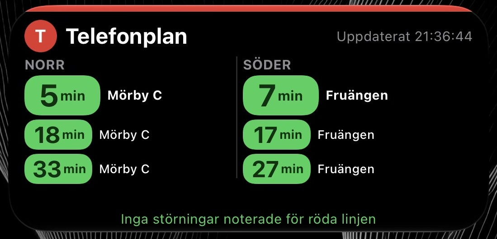
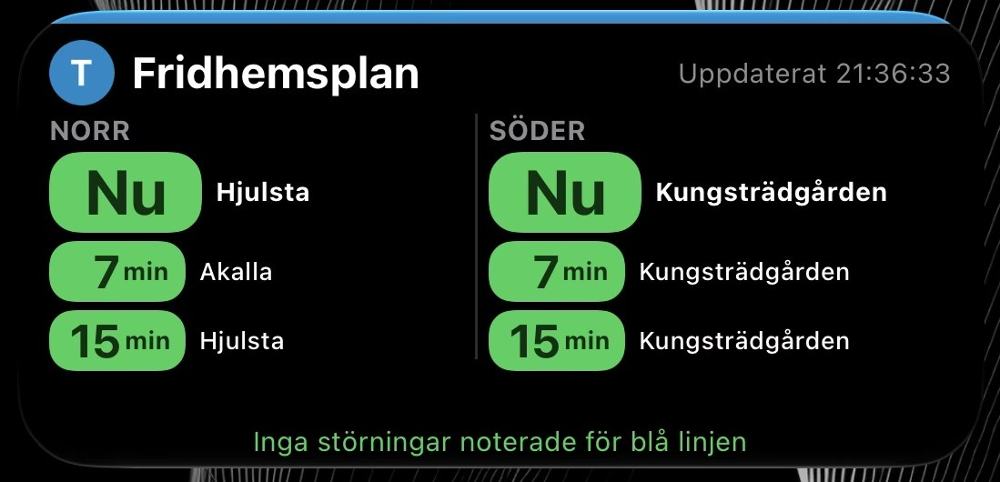

# SL-kollen

Scriptable-widgets för iPhone som visar SL-trafik från närmaste station: nästa tre avgångar åt varje håll, minuter kvar, färg för försening och trafikläget längst ner. Bara text, ingen karta. Finns för pendeltåg och tunnelbanans röda linje.

Repon hette först `sl-pendeln` och heter nu **SL-kollen**. Adresserna i laddarna pekar på det nya namnet.

## Så ser det ut
Pendeltåg:

Tunnelbanan, röda linjen:

Tunnelbanan, blå linjen:

## Filer
- `SL-pendeltag.js` – pendeltågs-widgeten. **Det här är filen du redigerar.**
- `Laddare.js` – liten laddare som alla användare klistrar in i Scriptable en gång. Den hämtar `SL-pendeltag.js` härifrån varje gång widgeten körs och sparar en kopia för när nätet saknas. Ändras aldrig.
- `SL-tunnelbana-roda.js` – tunnelbanans röda linje (13, 14), samma layout. Testad på telefon: avgångar, riktning och station fungerar (Telefonplan, linje 14).
- `Laddare-tunnelbana.js` – laddare för tunnelbane-widgeten (egen cache, påverkar inte pendeln).

- `SL-linje.js` – gemensam widget för fler linjer: röda, gröna och blå linjen, Roslagsbanan och Tvärbanan. Vilken linje som visas styrs av en rad i laddaren.
- `Laddare-linje.js` – laddare till `SL-linje.js`. Ändra raden `LINJE` (`"roda"`, `"gron"`, `"bla"`, `"roslagsbanan"`, `"tvarbanan"`) i ett eget skript per linje.

Lägg widgetarna ovanpå varandra på hemskärmen (iOS-stack) för att swipa mellan dem.

## Färdiga skript att kopiera
Mappen `kopiera/` har ett färdigt skript per linje. Öppna filen på GitHub, tryck på kopieringsknappen ("Copy raw file"), skapa ett nytt skript i Scriptable och klistra in. Inget behöver ändras.
- `Pendeltag.js`
- `Roda-linjen.js`, `Grona-linjen.js`, `Bla-linjen.js`
- `Roslagsbanan.js`, `Tvarbanan.js`

## Installera (för dig eller en kompis)
1. Installera appen Scriptable.
2. Nytt skript, klistra in innehållet i `Laddare.js`.
3. Kör skriptet **i appen** en gång (laddar ner stationslistan). Tillåt platsåtkomst, helst "Alltid".
4. Lägg till en Scriptable-widget (medium) på hemskärmen och välj skriptet.

## Uppdatera
Redigera `SL-pendeltag.js` här på GitHub. Alla får ändringen automatiskt, men GitHub cachar filen i ca 5 minuter.

## Regler för ändringar
- En ändring i taget. Testa, utvärdera, gå vidare.
- Testa i en egen fil (t.ex. `SL-pendeltag-test.js` med en egen laddare) innan du ändrar huvudfilen. Ett fel i huvudfilen slår ut alla användare.
- Den som använder laddaren kör kod från den här repon. Dela den bara med folk du litar på.

## Utseende
- Färgad list överst och en rund bokstav före rubriken: röd med "T" för tunnelbanan (röda linjen), rosa med "P" för pendeln. Färgerna är gissade (`LINE_COLOR` överst i varje fil), inte hämtade ur SL:s grafiska profil.
- Texten uppe till höger visar "Uppdaterat" med sekunder (HH:MM:SS).

## Färger (försening)
- Grön: 0–5 min
- Gul: 6–10 min
- Röd: över 10 min eller inställt (samma gränser som Trafikverkets tågkarta)

## Data
SL Transport API och SL Deviations API (öppna, ingen nyckel):
- `https://transport.integration.sl.se/v1`
- `https://deviations.integration.sl.se/v1`

## Känt / ej verifierat
- Riktning (NORR/SÖDER) via `direction_code` är bara kontrollerad vid Älvsjö.
- Stationsval via plats är inte bekräftat i alla lägen ("senaste plats" visas när plats saknas).
- Inställda tåg upptäcks med en gissning på fältet `state`.
- Grön text "Inga störningar" är inte sedd i praktiken än.

## Tunnelbana (röda linjen) – ej verifierat
- Station väljs bland röda linjens stationsnamn (lista i koden), annars de 20 närmaste platserna med röd avgång.
- NORR = mot Ropsten/Mörby centrum, SÖDER = mot Norsborg/Fruängen (efter destinationsnamn).
- Färggränser för försening är satta till gul 3–5 min, röd 6+ min (gissning, justera `LITE`/`MYCKET`).
- Röda linjen filtreras på `line.group_of_lines` / `line.designation` (13, 14). Fältnamnen är inte provade mot riktig data.
- Trafikläget filtreras på röda linjen via `scope.lines`; saknas den räknas störningen som relevant.
- Meddelanden om entréer, hissar, trappor och spärrar hoppas över (nyckelord i texten, `ACCESS` i koden), eftersom de inte påverkar tågen. Inte verifierat mot alla formuleringar SL använder.

## Fler linjer (SL-linje.js) – ej verifierat
Bara röda linjen är provad mot riktig data (via `SL-tunnelbana-roda.js`). För övriga är följande gissat:
- Gröna och blå linjen: samma API-läge som röda (METRO), linjenummer 17–19 respektive 10–11, riktning efter slutstation.
- Roslagsbanan: antas ligga under läget TRAIN, linje 27–29. Tvärbanan: antas ligga under TRAM, linje 30–31. Rubrikerna är VÄSTER/ÖSTER för Tvärbanan.
- Färger och bokstav är gissade: grön #2E9E4F, blå #0089CA, Roslagsbanan lila med R, Tvärbanan orange med Tv.
- Stationslistorna är ofullständiga. Hittas ingen station i listan används de 20 närmaste platserna, så långt från linjen kan det bli "Ingen station hittades".
- Störningar för Roslagsbanan och Tvärbanan räknas bara om meddelandet uttryckligen pekar ut linjen.
- Rubrik och trafikläge använder `label` i inställningarna överst i filen.

## Planerat
- Gröna och blå linjen (Farsta centrum ligger på gröna).
- Egen widget för buss.
