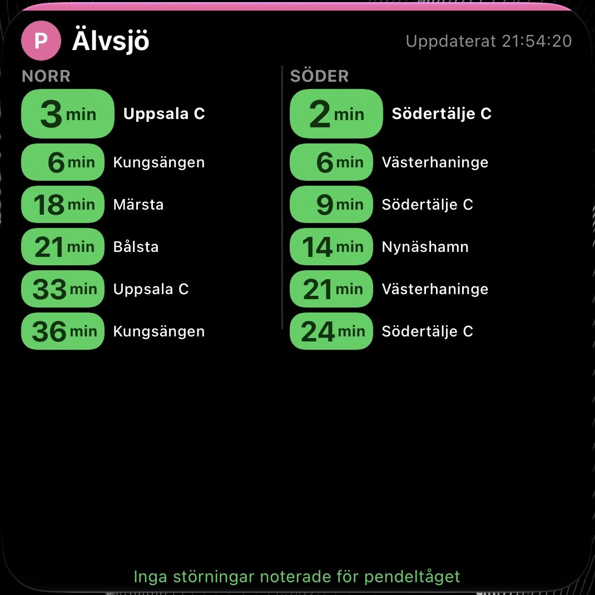

# SL-kollen

Widgets för iPhone som visar nästa avgångar från din närmaste SL-station eller SL-hållplats: minuter kvar, färg för försening och trafikläget. Bara text.

  
  
  

Storlekar: liten, mellan och stor.

## Multi – väljer själv
`Multi.js` hittar din närmaste station eller hållplats och visar alla avgångar därifrån i tidsordning. Station gäller tåg, tunnelbana, spårvagn och båt, hållplats gäller bussar. Brickan har linjens färg, och platsen visas som Spår, Läge eller Brygga. Det är den enklaste widgeten att börja med.

## Egna widgets per linje
Vill du ha en widget som alltid visar samma färdsätt finns de här:

- Pendeltåg
- Tunnelbanan: röda, gröna och blå linjen
- Roslagsbanan
- Tvärbanan
- Lidingöbanan
- Nockebybanan
- Saltsjöbanan
- Spårväg City
- Buss
- Båt
- Gula linjen (förberedd, öppnar senare)

## Kom igång
1. Installera appen **Scriptable** (kostnadsfri) från App Store.
2. Öppna mappen `kopiera/` här på GitHub, välj din linje och tryck på **Copy raw file**.
3. Skapa ett nytt skript i Scriptable, klistra in och kör det en gång i appen. Tillåt platsåtkomst (helst "Alltid").
4. Lägg till en Scriptable-widget på hemskärmen, håll in den, välj **Redigera widget** och välj skriptet.

Vill du ha flera linjer gör du ett skript per linje. Lägg widgetarna i en iOS-stack så kan du swipa mellan dem.

## Så läser du widgeten
- Pillerna visar minuter kvar. Grön är i tid, gul är försenad och röd är mycket försenad eller inställd.
- Längst ner står trafikläget. Grön text betyder inga störningar, gul är en störning.
- Stationen väljs automatiskt utifrån din plats.
- Buss, båt och Multi visar en lista över alla linjer från platsen i tidsordning, med linjenumret bredvid. Blåbussar har blå bricka och övriga bussar röd.
- Platsen står i en liten ruta: Spår för tåg och tunnelbana, Läge för buss och Brygga för båt.
- Stor buss- och Multi-widget visar upp till 10 avgångar. Finns det störningar visas de i sin helhet och tar då plats från de sista avgångarna.

## Status
Alla utom två är provade mot riktig data:
- **Båt** är inte provad än.
- **Gula linjen** (Fridhemsplan–Älvsjö) hade inte öppnat när SL-kollen byggdes. Skriptet är förberett i förväg och kan behöva justeras efter öppningen.

## Uppdateringar
Skripten hämtar sin kod härifrån varje gång de körs, så du får ändringar automatiskt (GitHub fördröjer ca 5 minuter). Det betyder också att du kör kod från den här repon, så dela den bara med folk du litar på.

Data kommer från SL:s öppna API:er (Transport och Deviations).
