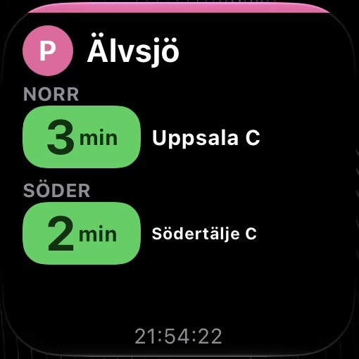

# SL-kollen

Widgets för iPhone som visar nästa avgångar från din närmaste SL-station eller SL-hållplats: minuter kvar, färg för försening och trafikläget. Bara text.

  

  

  

Storlekar: liten, mellan och stor.

## Närmast station – väljer själv
`Narmast-station.js` hittar din närmaste station eller hållplats och visar alla avgångar därifrån i tidsordning. Station gäller tåg, tunnelbana, spårvagn och båt, hållplats gäller bussar. Varje rad har en rund logga i trafikslagets färg (T, B, P, S, Bt), och platsen visas som Spår, Läge eller Brygga. Det är den enklaste widgeten att börja med.

## Hela stationen – du väljer själv
`Hela-stationen.js` visar alla avgångar från en station du bestämmer, till exempel vid jobbet eller skolan. Lägg ut widgeten, håll in den, välj Redigera widget och skriv stationens namn i fältet Parameter, till exempel Årstaberg. Kör skriptet i Scriptable en gång först.

## Välj station på alla widgets
Alla widgets tar närmaste station som standard, och då visas en liten måltavla i headern. Vill du låsa en widget till en egen station, till exempel Stockholms östra, gör du på något av tre sätt (första träffen gäller):

1. Skriv stationens namn i widgetens **Parameter** (håll in widgeten, Redigera widget).
2. Skriv namnet på raden `STATION` överst i skriptet.
3. Kör skriptet i Scriptable och välj **Välj station** i rutan som kommer upp. Där kan du också gå tillbaka till **Närmaste station**.

En låst widget visar ett lås i headern och bara sitt eget färdsätt. Roslagsbanan på Stockholms östra visar alltså bara Roslagsbanan. **Hela stationen** visar däremot allt på stationen.

## Egna widgets per linje
Vill du ha en widget som alltid visar samma färdsätt finns de här:

- Pendeltåg
- Tunnelbanan: röda, gröna och blå linjen
- Roslagsbanan
- Tvärbanan
- Lidingöbanan
- Nockebybanan
- Saltsjöbanan
- Spårväg City
- Buss
- Båt
- Gula linjen (förberedd, öppnar senare)

## Kom igång
1. Installera appen **Scriptable** (kostnadsfri) från App Store.
2. Öppna mappen `kopiera/` här på GitHub, välj din linje och tryck på **Copy raw file**.
3. Skapa ett nytt skript i Scriptable, klistra in och kör det en gång i appen. Tillåt platsåtkomst (helst "Alltid").
4. Lägg till en Scriptable-widget på hemskärmen, håll in den, välj **Redigera widget** och välj skriptet.

Vill du ha flera linjer gör du ett skript per linje. Lägg widgetarna i en iOS-stack så kan du swipa mellan dem.

## Så läser du widgeten
- Pillerna visar minuter kvar (eller "Nu"). I linjewidgetarna med två kolumner står linjenumret i en liten bricka före destinationen och spårnumret i en grå ruta efter den, om SL skickar ett spår.
- Grön är i tid, gul är försenad och röd är mycket försenad eller inställd.
- Längst ner står trafikläget. Grön text betyder inga störningar, gul är en störning.
- Stationen väljs automatiskt utifrån din plats, om du inte har låst den (se ovan).
- Rubrikerna är NORR och SÖDER för tunnelbana, pendeltåg och Roslagsbanan. Övriga banor har "Mot ändstation", till exempel MOT NOCKEBY och MOT ALVIK.
- På en ändstation, där tågen bara går åt ett håll, delas tågen i två kolumner i tidsordning i stället för en tom kolumn.
- Buss, båt, Närmast station och Hela stationen visar en lista över alla linjer från platsen i tidsordning, med linjenumret bredvid. Blåbussar har blå bricka och övriga bussar röd.
- Långa stationsnamn förkortas (till exempel Sthlm Ö, Mörby C, Farsta str.) och textstorleken räknas ut per namn, så att inget klipps. Storleken är kalibrerad mot riktiga skärmdumpar.
- Platsen står i en liten ruta: Spår för tåg och tunnelbana, Läge för buss och Brygga för båt.
- Stor buss-, Närmast station- och Hela stationen-widget visar upp till 10 avgångar. Finns det störningar visas de i sin helhet och tar då plats från de sista avgångarna.

## Namnprov
`Namnprov.js` (i `kopiera/`) är ett testskript som ritar 60 stationsnamn i de riktiga raderna, så att du kan kontrollera att inget namn klipps på just din telefon. Kör det i Scriptable och välj sida 1, 2 eller 3. Det påverkar inga andra widgets.

## Status
Alla utom två är provade mot riktig data:
- **Båt** är inte provad än.
- **Gula linjen** (Fridhemsplan–Älvsjö) hade inte öppnat när SL-kollen byggdes. Skriptet är förberett i förväg och kan behöva justeras efter öppningen.

## Uppdateringar
Skripten hämtar sin kod härifrån varje gång de körs, så du får ändringar automatiskt (GitHub fördröjer ca 5 minuter). Det betyder också att du kör kod från den här repon, så dela den bara med folk du litar på.

Data kommer från SL:s öppna API:er (Transport och Deviations).
