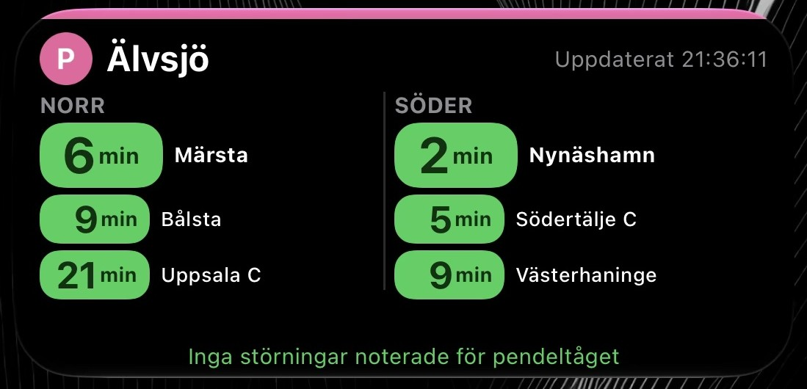

# SL-kollen

Scriptable-widgets för iPhone som visar SL-trafik från närmaste station: nästa avgångar åt varje håll, minuter kvar, färg för försening och trafikläget längst ner. Bara text, ingen karta.

Linjer: pendeltåg, tunnelbanans röda, gröna och blå linje, Roslagsbanan och Tvärbanan.

Exempel Pendeltåg:

**Liten**

**Mellan**

**Stor**

## Kom igång
1. Installera appen **Scriptable** från App Store.
2. Öppna mappen `kopiera/` här på GitHub, välj linjen du vill ha och tryck på **Copy raw file** (kopieringsikonen uppe till höger).
3. Skapa ett nytt skript i Scriptable, klistra in och kör det **i appen** en gång. Tillåt platsåtkomst (helst "Alltid") och se till att du har nät.
4. Lägg till en Scriptable-widget på hemskärmen, håll in den, välj **Redigera widget** och välj skriptet.

Vill du ha flera linjer gör du ett eget skript per linje. De kan läggas ovanpå varandra som en iOS-stack så att du kan swipa mellan dem.

## Filer
- `kopiera/` – färdiga skript att klistra in i Scriptable: `Pendeltag.js`, `Roda-linjen.js`, `Grona-linjen.js`, `Bla-linjen.js`, `Roslagsbanan.js`, `Tvarbanan.js`. Varje skript hämtar sin widget härifrån varje gång den körs och sparar en kopia för när nätet saknas.
- `widgets/pendeltag.js` – pendeltågswidgeten.
- `widgets/linjer.js` – widgeten för tunnelbanan, Roslagsbanan och Tvärbanan. Vilken linje som visas styrs av raden `LINJE` i skriptet.
- `bilder/` – förhandsbilder.

Ändringar görs i `widgets/`. Alla som klistrat in ett skript får ändringen automatiskt, men GitHub cachar filerna i ca 5 minuter.

## Utseende
- Färgad list överst och ett rundat märke med linjens bokstav före stationsnamnet. Uppe till höger står "Uppdaterat" med klockslag och sekunder.
- Pillerna visar minuter kvar. Grön är i tid, gul är försenad och röd är mycket försenad eller inställd.
- Försening, tunnelbana: gul från 3 min, röd från 6 min. Pendeltåg: gul från 6 min, röd från 11 min.
- Trafikläget står längst ner. Grön text betyder inga störningar, gul är en störning. På tunnelbanan hoppas meddelanden om entréer, hissar och trappor över.

## Storlekar
Widgeten anpassar sig efter storleken du väljer på hemskärmen:
- **Liten:** stationsnamn och nästa avgång åt varje håll. Visar "Störning" i gult om det finns en, annars klockslaget.
- **Medium:** tre avgångar åt varje håll och trafikläge.
- **Stor:** upp till sex avgångar åt varje håll (om SL levererar så många).

Att köra skriptet inuti Scriptable visar alltid mediumvarianten.

## Linjer och stationer
- Stationen väljs automatiskt utifrån din plats. Saknas plats visas senast använda station.
- Tunnelbana: norr är mot Ropsten, Mörby centrum, Akalla, Hjulsta, Åkeshov, Alvik och Hässelby strand. Söder är mot de övriga ändstationerna.
- Roslagsbanan och Tvärbanan: rubrikerna är NORR/SÖDER respektive VÄSTER/ÖSTER.

## Begränsningar
- Provat mot riktig data: pendeltåg, röda och blå linjen. Gröna linjen, Roslagsbanan och Tvärbanan är inte provade, och färgerna och linjenumren för dem är antaganden.
- Riktningen på pendeln är kontrollerad vid Älvsjö.
- Stationslistorna för tunnelbana, Roslagsbanan och Tvärbanan är ofullständiga. Hittas ingen station på linjen används de 20 närmaste platserna, så långt från linjen kan det bli "Ingen station hittades".
- Störningar för Roslagsbanan och Tvärbanan räknas bara om meddelandet pekar ut linjen.
- Färgerna på listerna är valda efter utseende och inte hämtade ur SL:s grafiska profil.

## Data
SL Transport API och SL Deviations API (öppna, ingen nyckel):
- `https://transport.integration.sl.se/v1`
- `https://deviations.integration.sl.se/v1`

Den som klistrar in ett skript kör kod från den här repon. Dela den bara med folk du litar på.
